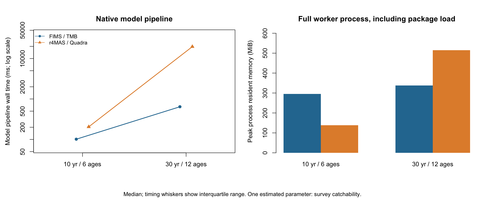

# FIMS/TMB versus r4MAS/Quadra: first matched-model benchmark

Generated: 2026-11-11 17:35:44 EST

## Scope

A small simulated, one-area, two-sex (r4MAS) / aggregated-sex (FIMS) catch-at-age model with one fishing fleet and one biomass survey. Only survey catchability q is estimated. Natural mortality, annual F, weight at age, selectivity, initial abundance, recruitment scale, and steepness are fixed. The finite-logit h = 1 - 1e-12 Beverton–Holt limit gives effectively constant recruitment. This is a first fixed-dynamics comparison, not a high-dimensional stock-assessment or random-effects benchmark.

The shared specification is generated once per case, with a fixed seed. Both models use lognormal catch and survey likelihoods without observation bias correction. r4MAS inputs are converted to thousands of fish and kg; results are converted back to fish and metric tons. The same initial numbers are encoded using fixed r4MAS initial deviations, including its native initial-F bisection and initial-abundance offset.

## Timings

Each repeat uses a fresh R process and loads only one modeling package. Package and Rcpp interface initialization occur before the model-pipeline timer. Engine order alternates across repeats. Timing includes object construction, native setup/taping, optimization, native uncertainty reporting, native export and reading that export. Native stages differ across packages, so the primary comparison is the total pipeline, not individual stage labels. R4MAS additionally writes its normal JSON output during Run. These are package-workflow timings, not isolated AD backend throughput. r4MAS propagates two sex-specific states and repeats a native initial-F solve; FIMS propagates an aggregated state and accepts initial abundance directly. Those representation and initialization costs are included.

| Case | Dimensions | FIMS/TMB median [IQR], ms | r4MAS/Quadra median [IQR], ms | r4MAS / FIMS | Repeats per engine |
|---|---|---:|---:|---:|---:|
| small | 10 years × 6 ages | 101.33 [100.82–105.14] | 204.75 [200.85–207.45] | 2.02× | 5 |
| medium | 30 years × 12 ages | 642.76 [634.82–665.89] | 19656.09 [19608.84–19784.74] | 30.58× | 5 |

## Resource-limited cases

Cases without the requested number of paired fits are excluded from the speed summary. Completed unpaired measurements remain in raw-results.csv with included_in_summary = FALSE.

| Case | Engine | Stage | Observed process seconds | Peak RSS, MiB | Budget seconds | Outcome |
|---|---|---|---:|---:|---:|---|
| large | r4MAS | fixed preflight | 147.19 | 1331.1 | 120 | Preflight completed above budget; subsequent fit interrupted after 78 s; excluded from paired summary |

The worker budget includes package loading. Manually stopped exploratory runs may have observed times above that budget; the outcome column records what completed and what was interrupted. The runner enforces a configurable 120-second timeout by default. No speed ratio is claimed for an incomplete paired case.

## Numerical agreement

Every fixed-parameter preflight and fitted repeat must pass the checks before a speed summary is generated. The checks compare numbers at age, biomass, catches, survey predictions, normalized likelihood, fitted q, and its analytic SE. With fixed population dynamics, the oracle is log(q_hat) = mean(log(index / vulnerable_biomass)) and SE(q_hat) = q_hat * sqrt(log(1 + CV^2) / n_years).

FIMS estimates log(q); its TMB sdreport SE is transformed onto physical q for comparison. r4MAS reports a physical-q SE through Quadra. Likelihood constants (the FIMS lognormal Jacobian and normalizing constants, and constant r4MAS recruitment/selectivity contributions) are removed before comparing objective values. Raw objectives remain in each worker result.

| Case | Maximum relative q error | Maximum relative SE error | Maximum N-at-age relative error | Raw SSB discrepancy | SSB discrepancy after convention diagnostic |
|---|---:|---:|---:|---:|---:|
| small | 2.57e-13 | 1.85e-13 | 2.73e-13 | 0.1313% | 2.38e-13 |
| medium | 2.55e-13 | 1.95e-13 | 2.05e-13 | 0.0725% | 1.89e-13 |

**SSB finding:** r4MAS omits the first-age recruit contribution to SSB after the initial year in this case. `accuracy.csv` retains that raw discrepancy. Adding the known omitted contribution is a diagnostic only; neither native output is changed. The accuracy gate checks the explained convention difference, rather than claiming raw SSB equality. The discrepancy does not materially affect the selected likelihood in this near-constant-recruitment case. More general stock–recruitment comparisons require resolving that difference first.

**Catch convention:** r4MAS adds a 1e-5 metric-ton catch floor. The explicit catch check allows that absolute floor; all other main state comparisons use relative tolerance 1e-8. q uses relative tolerance 1e-7; SE uses 1e-5; normalized NLL uses absolute tolerance 1e-5.

**Gradient diagnostics:** each worker retains the package-native gradient and its coordinate (q versus log(q)). A standardized gradient (gradient × parameter SE) is included in raw results for inspection. Numerical fit gates use the analytic MLE/SE and native convergence status; no claim of raw-gradient equality is made.

## Memory and reproducibility

RSS is the maximum resident memory of the entire worker, measured by the OS, including R and package/module loading. It is not incremental model allocation and should not be interpreted as a pure AD tape-memory comparison. Cold-process elapsed times and package/module load times are separately retained in raw-results.csv. Single-thread environment settings are requested for OpenMP and common BLAS implementations. OS file caches are not flushed; cold process means a fresh R interpreter.

| Engine | Package version | Installed library | DLL MD5 |
|---|---|---|---|
| FIMS | 0.11.0.9000 | `/Users/matthew.supernaw/Library/R/arm64/4.4/library/FIMS` | `eea56992c5eb164e8d3dad6cd4280b09` |
| r4MAS | 0.1.0 | `/private/tmp/r4mas-default-build-lib/r4MAS` | `bf36d7f7367f3bfae7017b451d823bf4` |

R: R version 4.4.3 (2025-02-28)
Platform: aarch64-apple-darwin20
OS: Darwin 24.6.0
CPU: Apple M3 Pro

The exact installed FIMS source commit is not available in package metadata; its DLL hash identifies the binary used. The r4MAS Quadra source revision is recorded in src/mas/third_party/Quadra/UPSTREAM.md.

Small samples on one machine are exploratory. Native reporting workloads and Rcpp object layers differ; the timing ratios are not general FIMS/TMB-versus-Quadra performance claims.

Files: `summary.csv`, `raw-results.csv`, `stage-timings.csv`, `accuracy.csv`, and generated `cases/*.rds`. Each `workers/` subdirectory retains logs, native JSON, normalized results, and session information.
